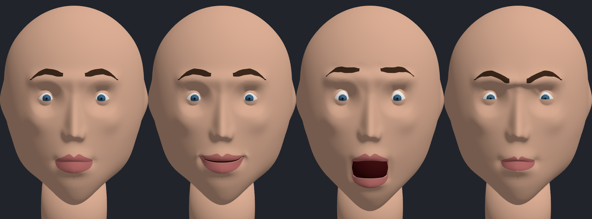
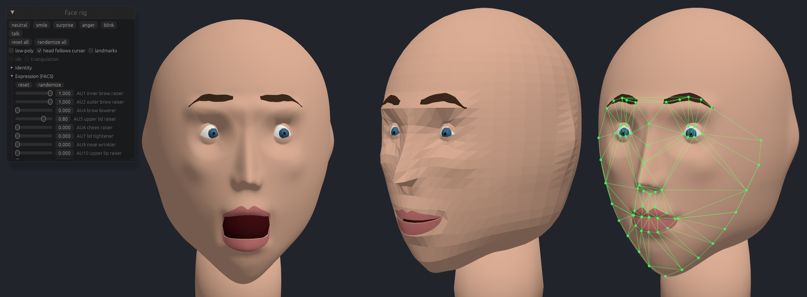

# face-shape

A hand-rolled, parametric 3D face for [game-toolkit]: no imported mesh, no textures, just a
latitude/longitude grid that a few dozen sliders push, pull and rotate into a face. The long game
is to take a screenshot of a face and have a fitter find the slider values that reproduce it; this
is the part where I get to tune them by hand first.





## Where the code lives

The rig is a crate inside the game-toolkit workspace, on its `face-rig` branch:

- `crates/face` (`game-toolkit-face`) is the rig itself. Without its default `gfx` feature it has
  no dependencies at all, which keeps it usable for headless fitting later on.
- `examples/20_face` is the viewer from the screenshots above.

This repository holds the notes and a `Taskfile.dist.yaml` that runs everything over there, scoped
to those two packages. It expects game-toolkit next to it (`../game-toolkit`); pass
`TOOLKIT=/path/to/game-toolkit` otherwise.

```sh
task run                          # the viewer
task run -- smile                 # ... starting on a preset
task shot PRESET=anger YAW=0.6    # screenshot to shots/anger_0.6.png
task test                         # rig tests
task ci                           # fmt check, clippy (native, no-default-features, wasm32), docs, tests
```

## How the rig works

Every value the rig knows about sits in one flat, bounded vector (`FaceParams`, described by the
`PARAMS` table): 16 identity parameters in `[-1, 1]`, 16 FACS action units in `[0, 1]`, and 8 pose
parameters in radians. A fitter wants exactly that shape, so the sliders get it too.

The mesh is a latitude/longitude grid over an ellipsoid, denser at the face (128×112 columns and
rows, about 14k vertices; the low-poly mode uses 40×34). The mouth and both eyes are cut lines in
that grid: the vertices along each cut exist twice, once for the triangles above and once for those
below, so lips can part and lids can close without any special casing. Every vertex also keeps its
canonical *domain* coordinate (longitude and latitude, face centre at the origin), and everything
else is defined there, which is why shape, muscles, landmarks and the brow and lip decals keep
sticking to the same features no matter how the head is reshaped.

Evaluating the rig runs four steps:

1. The identity parameters sculpt a neutral head: domain warps move whole regions (eye spacing,
   mouth width, chin length), smooth height bumps add the nose, brows, cheekbones, lips, chin and
   ears, and the skin around each eye wraps onto a sphere around the eyeball, so the lids can rotate
   over it.
2. The action units are Waters-style muscles: a linear muscle is anchored at an origin and pulls
   the skin around its insertion toward it, a sphincter contracts a ring (the pucker, the lip
   tightener). Each one is evaluated once per identity at full strength and baked into a per-vertex
   delta, i.e. a blend shape, so an expression is simply the weighted sum of those deltas and stays
   linear in its parameters. The lid and lip openings come from re-running the sculpt with the lids
   or lips moved instead.
3. Bones: the head rotates about the neck, the jaw about its hinge, the eyes about their centres.
   The skin follows by linear blend skinning with a single procedural jaw weight per vertex.
4. Vertex normals, area-weighted.

On top of that, 68 landmarks in the iBUG 300-W layout are pinned to vertices, and
`FaceRig::landmark_triangles()` triangulates them (Delaunay, once, on the frontal face). That
triangulation is the one Active Appearance Models and face-morphing tools use to warp texture
piecewise-affinely between a photo and a model, so it doubles as the bridge to the fitting part.

## The viewer

Drag to orbit, scroll to zoom. The panel has the presets (neutral, smile, surprise, anger, blink,
talk), a reset and a randomize button per group and for everything, and toggles for the low-poly
mesh and the landmark overlay. Changes morph in over a fraction of a second rather than jumping,
which makes "randomize all" rather more fun than it has any right to be.

The eyes follow the cursor, aimed in head space so they stay on target however the head is posed.
The head follows too (it has its own toggle), turning a little at first and more once the eyes run
out of lid opening; it holds still while you click, drag, scroll or type, and comes back to life
1.5 s later, so a pose set by hand survives long enough to look at.

For screenshots: `--shot out.png` saves a frame once the scene has settled and quits, `--yaw R` orbits the camera,
`--look X,Y` pins the cursor the eyes follow, `--landmarks` turns on the overlay, `--low` starts
in low-poly mode, and `--ui` keeps the panel in the picture.

## Things that bit

Two of the bugs were geometry rather than code, and both are the kind of thing I'd run into again.

The neutral mouth smiled. The mouth slit is a latitude ring, and a horizontal ring below eye level,
seen from the front, curves up at both ends (it's the bottom half of an ellipse in perspective, after
all). The fix is a domain warp that drops the mouth corners just enough for the line to look straight
head-on.

Pressing the lips together pulled them apart. Each copy of a cut vertex only sees the triangles of
its own lip, so the upper lip's normals tilt down and the lower lip's tilt up; a muscle that pushes
"into the face" along the normal then pries the closed lips open. The neutral normals the muscles
use are now averaged across each pair of copies.

## Status

Works, with rough edges:

- The smile is on the timid side next to the other presets, and the head looks a bit like a ball
  in profile.
- Every identity change rebuilds the neutral and all blend shapes, about 13 ms in a release build,
  so the frame rate dips while identity values morph.
- With the camera orbited far to the side, head and eyes run out of range before they reach the
  cursor; the neck is a static shape that doesn't follow the head.

Next up: a reference image as an overlay, clicking the 68 landmarks onto it, and then a
Levenberg-Marquardt fit of pose, identity and expression to those points.

[game-toolkit]: https://github.com/sunsided/game-toolkit
